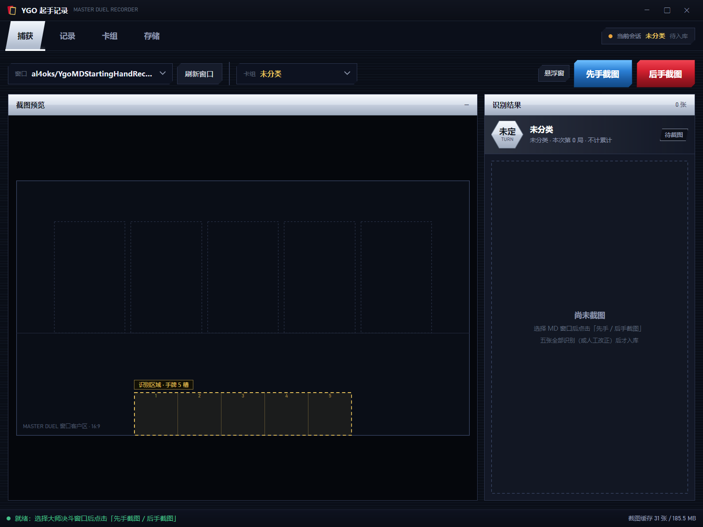
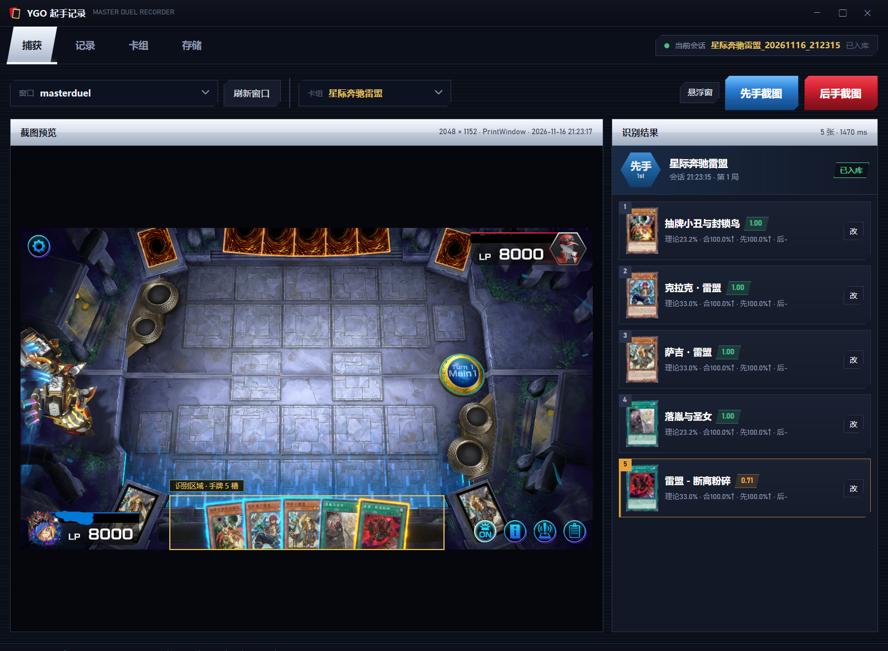
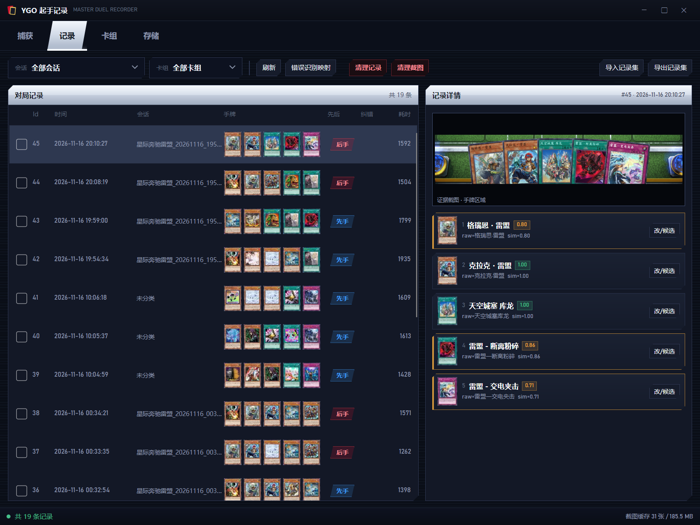
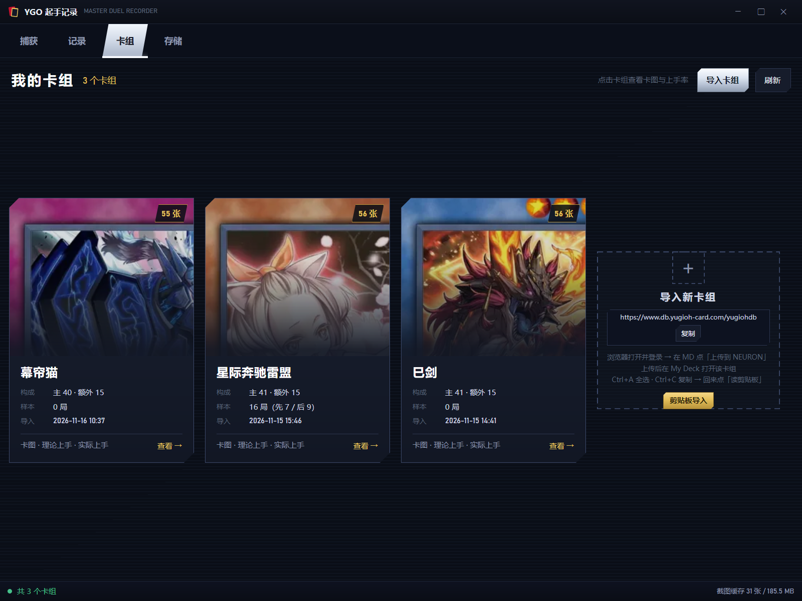
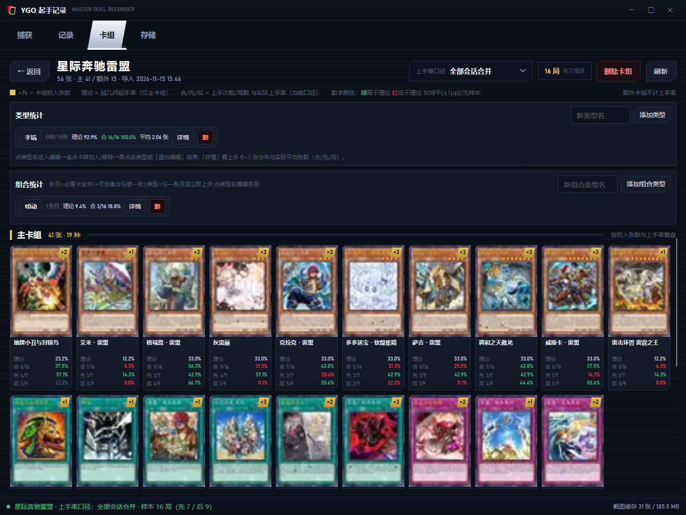
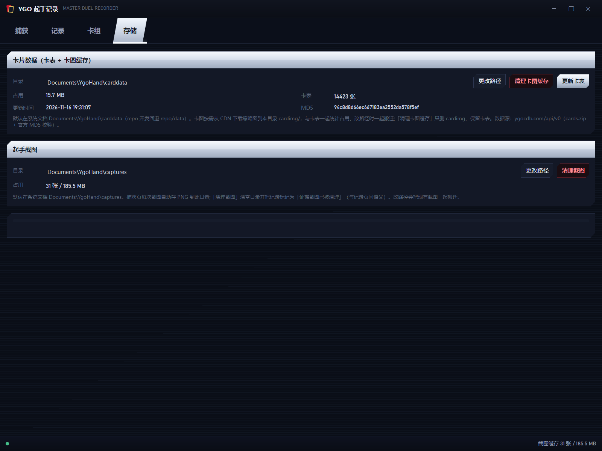

# YgoMDStartingHandRecorder（YGO 起手记录）

被动记录《游戏王 MASTER DUEL》（简中、窗口化客户端）每局**起手 5 张**（先手/后手均 5 张）的本地工具：手动点一次「先手截图 / 后手截图」即完成 截图 → OCR 识别 → 存证 → 入库，并按卡组统计上手率。无实时循环、不录视频、不抽帧。

> 状态框：项目处于早期公开阶段，API 与数据库 schema 仍可能变动。

## 功能特性

- 一步捕获：PrintWindow 主路径（遮挡/锁屏可用、不抢焦点），WGC 回退（Unity/DX 窗口）
- 识别：PaddleOCR 两段检测/识别 + 尺寸过滤 + 空槽重试；别名闭环（人工纠正 → 下次精确命中）
- 记录页：会话/卡组过滤、证据图核对、逐槽纠正与候选、错误识别映射、导出/导入记录集、清理
- 卡组页：官方卡组站剪贴板零 OCR 导入；类型/组合统计（超几何理论上手率 vs 实际上手率，合/先/后三桶）
- 捕获页悬浮窗：置顶小窗只放截图按钮 + 五卡名 + 合计上手率，摆游戏旁边
- 存储页：卡表下载/更新（官方 MD5 校验）、截图与卡图缓存目录可改路径（整树搬迁）、占用统计与清理
- 单文件便携发布：self-contained 单 exe，拷到任意目录双击运行；**卡表不内嵌**，首启提示下载

## 截图

> 以下为作者实机 / 种子数据示例；个人路径与玩家名已遮罩。画面中的卡图缩略图为 Konami 素材（见「版权与声明」）。

**捕获页**（空状态 → 一键截图识别入库）：




**记录页**（会话/卡组过滤 + 证据图核对 + 逐槽纠正）：



**卡组页**（卡组一览 + 官方卡组站剪贴板导入）：



**卡组详情**（类型/组合统计 + 理论 vs 实际上手率）：



**存储页**（卡表更新 / 缓存目录改路径与清理）：



## 环境要求

- Windows 10 19041+ / Windows 11，x64
- 开发构建：.NET 11 SDK（`net11.0-windows10.0.19041.0`）
- 运行单文件 exe：无需安装 .NET
- 捕获对象：用户自行合法安装并运行的《游戏王 MASTER DUEL》简中窗口化客户端

## 快速开始

```bash
dotnet build YgoMDStartingHandRecorder.slnx
dotnet run --project src/YgoMDStartingHandRecorder          # 开发运行（repo 内自带 data/config.json）
dotnet publish src/YgoMDStartingHandRecorder -c Release -p:PublishProfile=SingleFile
# 产物: src/YgoMDStartingHandRecorder/bin/Release/net11.0-windows10.0.19041.0/win-x64/publish/YgoMDStartingHandRecorder.exe
```

首次启动若无卡表会弹「缺少卡片数据」提示，点「下载」从百鸽数据源拉取（zip 约 2.4MB，带官方 MD5 校验与进度条）；也可稍后到「存储」页下载。运行时在 root 旁自动建 `records/`、`captures/`、卡片数据目录（默认系统文档 `Documents\YgoHand\`，可改）。

卡组导入：MD 内「导出」到官方卡组站 → 浏览器打开「我的卡组」（可切 List 视图）→ Ctrl+A/Ctrl+C → 程序「导入卡组」读剪贴板 → 预览确认入库。

更多用法见 [docs/usage.md](docs/usage.md)，架构见 [docs/design.md](docs/design.md)。

## 测试

仓库**不含游戏截图样张**（版权与隐私原因，见下）。headless 测试中 CardLib.Smoke 开箱即跑；Records.Smoke 依赖卡表，先 `python tools/fetch_cards.py`（或程序内下载）生成 `data/cards.json`：

```bash
dotnet run --project tests/Ygo.CardLib.Smoke
dotnet run --project tests/Ygo.Records.Smoke     # 缺样张时自动跳过别名识别块并打印 SKIP
```

识别评测与 UIA 端到端冒烟需自备样张：用 `src/Ygo.Labeler` 标注自己的截图，放到 `samples/own/`（文件名格式 `{stem}__{卡1}+…+{卡5}.ext`，见 usage.md），再跑：

```bash
dotnet run --project tests/Ygo.Recog.Eval --no-build -- <root> samples/own
powershell -NoProfile -File tests/av-portable-smoke.ps1   # 需 samples/own 内含 *005109* 样张
```

`tests/av-portable-smoke.ps1` 需要交互桌面（UIA），不能在无头 CI 中运行。

## 目录结构

```
src/YgoMDStartingHandRecorder/   Avalonia 12 UI 头（捕获/记录/卡组/存储四页 + 悬浮窗）
src/Ygo.Records/                 共享层：SQLite 记录库/上手率统计/捕获 interop/卡表更新/设置
src/Ygo.Recognition/             PaddleOCR 识别管线
src/Ygo.CardLib/                 卡表索引/别名/模糊匹配/文件名标签 codec/ROI 契约
src/Ygo.Labeler/                 样张标注工具（WinForms）
tests/                           headless smoke ×3 + 识别评测 + 便携 UIA 冒烟
tools/                           fetch_cards.py / check_labels.py（纯标准库）
data/config.json                 识别契约（handRoi/upscale/slots/分隔符）
docs/                            usage / design
```

## 开发心得

<!-- 作者填写：设计取舍、踩坑与收获。可参考话题：只读像素的合规边界、PrintWindow/WGC 双捕获路径、两段 OCR 与超框卡的卡组约束、超几何上手率统计、Avalonia 12 迁移与自定义标题栏、单文件发布的体积取舍等。 -->

*（作者撰写中……）*

## 已知缺失功能

<!-- 作者填写：当前版本尚未实现 / 计划中的功能清单（含调研过但未开工的方向）。 -->

*（作者整理中……）*

## 卡表数据来源与鸣谢（ygocdb / 百鸽）

- 卡表 `cards.zip`（含官方 MD5 校验文件）与卡图缩略图 CDN 由 **ygocdb（百鸽）** <https://ygocdb.com> 提供（API：`ygocdb.com/api/v0`）。**感谢百鸽提供的开放卡表与卡图数据服务。**
- 本仓库**不再分发卡表数据**：程序内置下载器与 `tools/fetch_cards.py` 在运行时按需拉取；卡图按需从 CDN 缓存缩略图到本地。
- 卡表内容（卡名/文案/密码等）的著作权属于 Konami；百鸽为社区数据整理方。使用其数据请遵守其服务条款。

## 版权与声明（Konami）

- 本项目为**非官方粉丝工具**，与 Konami（株式会社科乐美数码娱乐）无任何关联，亦未获其认可或赞助。
- 「游戏王」「遊☆戯☆王」「Yu-Gi-Oh!」「MASTER DUEL」等商标，以及卡片名称、卡图、卡片文案的著作权与商标权均归 **Konami** 所有。
- 本仓库不分发任何游戏客户端文件、卡图或卡表数据；运行时卡表/卡图来自上述第三方数据源，由用户自行拉取。
- 使用前提：用户自行合法持有并安装《游戏王 MASTER DUEL》客户端。本工具仅读取该窗口的屏幕像素，详见下节。
- 用户应自行确认其使用方式符合游戏服务条款与当地法律；作者不对使用本工具产生的任何后果负责。

## 合规红线（设计约束）

- **只读屏幕像素**：不读游戏内存、不改包、不注入、不 hook。
- **对 MD 窗口零输入**：不发送任何键鼠消息；捕获用 PrintWindow/WGC 被动读取。
- 无实时循环、无视频录制；每次捕获均由用户手动点击触发。

## 许可证

本项目源码以 [MIT](LICENSE) 许可证发布。

随单文件 exe 分发的第三方组件（.NET 运行时、Avalonia、SkiaSharp、PaddleOCR 及模型权重、OpenCV 等）各自遵循其许可证，清单见 [THIRD-PARTY-NOTICES.md](THIRD-PARTY-NOTICES.md)；再分发二进制时请保留该声明。

## 鸣谢

- [ygocdb（百鸽）](https://ygocdb.com)：卡表与卡图数据服务
- Konami：《游戏王 MASTER DUEL》原作（见版权声明）
- 各开源依赖作者（见 THIRD-PARTY-NOTICES.md）
<!-- TODO: 贡献者名单 -->